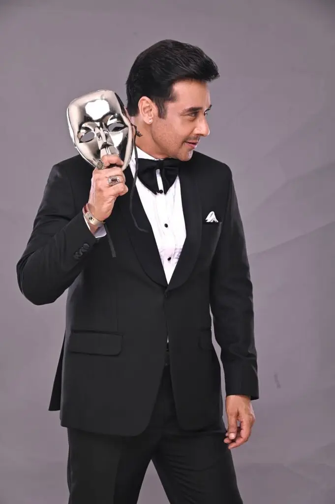
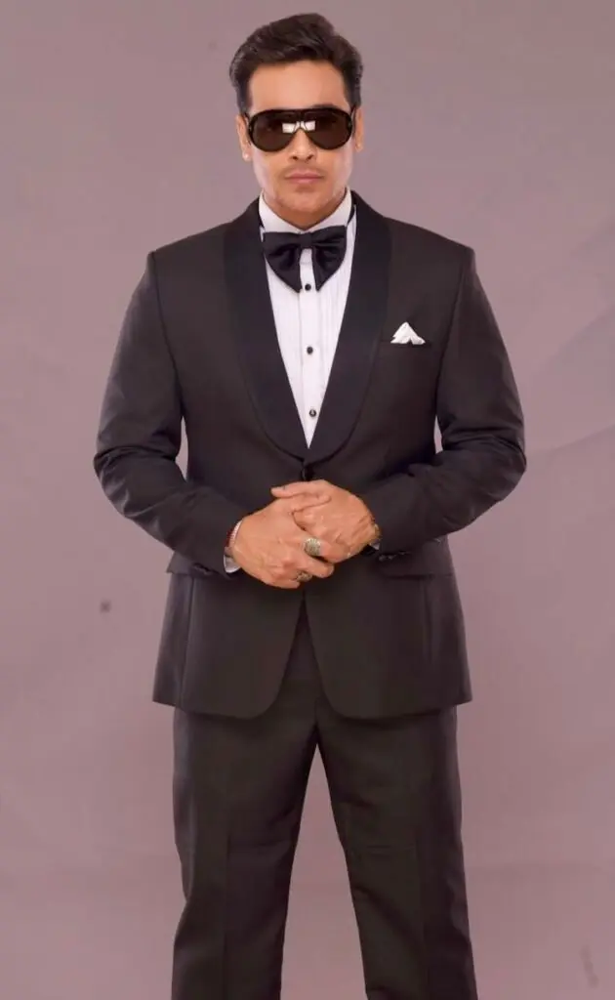
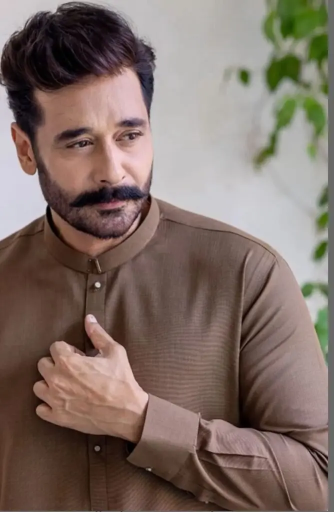
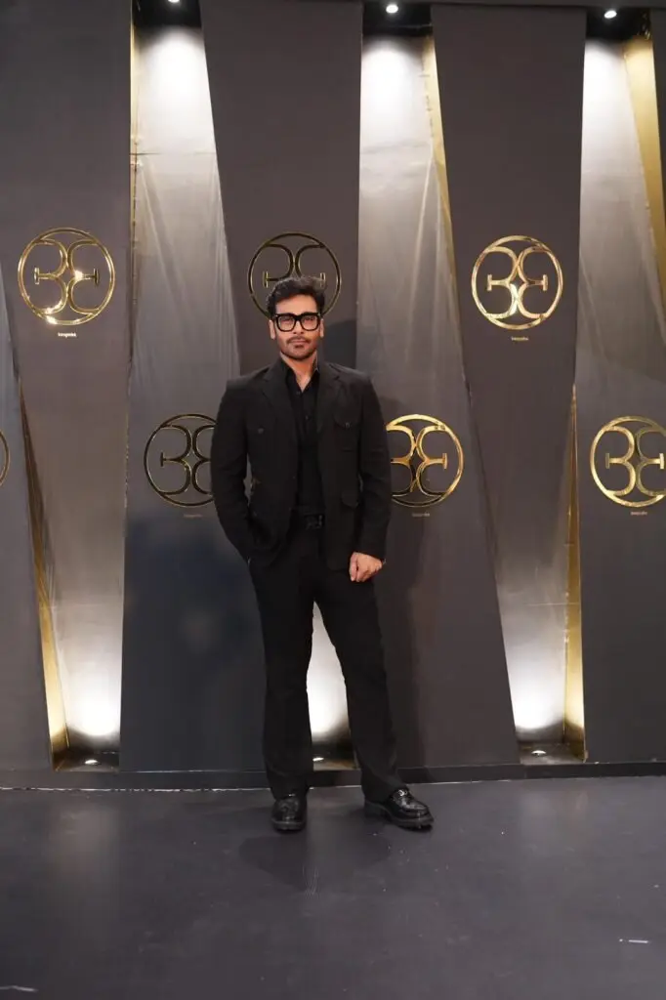
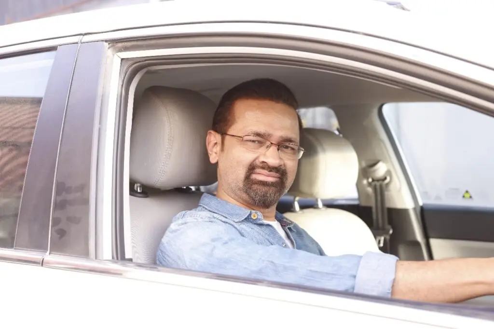

![[me/the-three-faisal-qureshis/The Three Faisal Qureshis of Pakistani Media-faisalqureshi-com.webp|700x393]]

Pakistan's media is filled with stars, but have you ever noticed how many share the same name?

It might be hard to believe, but there are at least **three Faisal Qureshis in Pakistani media**. And people often confuse one with the other.

The three of us are good friends and have even [[three-faisal-qureshis-old-shows|appeared on TV together]] more than once. [[three-faisal-qureshis-old-shows|You can watch some old clips here]].

Here’s a bit about all three of us, to help you keep us straight.

---

## Faysal Quraishi - Actor/Host

  

  

  

  
  
  
  
  

The actor, producer, and show host, [[me/the-three-faisal-qureshis/faysal-quraishi/index|Faysal]] is widely recognized for his acting prowess in numerous drama serials and films. You can connect with him at [Instagram](https://www.instagram.com/faysalquraishi/)
[X](https://x.com/faysalquraishi)
[Facebook](https://www.facebook.com/faysalq)
[Threads](https://www.threads.com/@faysalquraishi)

---

## Faisal Qureshi - Film-maker/Actor

  
  
  

[[me/the-three-faisal-qureshis/faisal-qureshi-filmmaker/index|Faisal]] is a versatile television personality, working as a television actor, director, producer, screenwriter, filmmaker, and humorist. You can connect with him at
[Facebook](https://www.facebook.com/faisal.qureshi111)
[Instagram](https://www.instagram.com/faisalqureshi_fq/).

---

## Faisal Qureshi - Host/Journalist/Broadcaster

  
  
  
  
  
  

This is me. I’ve hosted TV shows in Pakistan on various channels. My main focus used to be social issues. But somehow, I also started doing current affairs shows.

That makes me a pseudo-journalist.

I say "pseudo" because I never went to journalism school. It's not my full-time career. I only did it part-time.

You can connect with me [[contact|here]].
